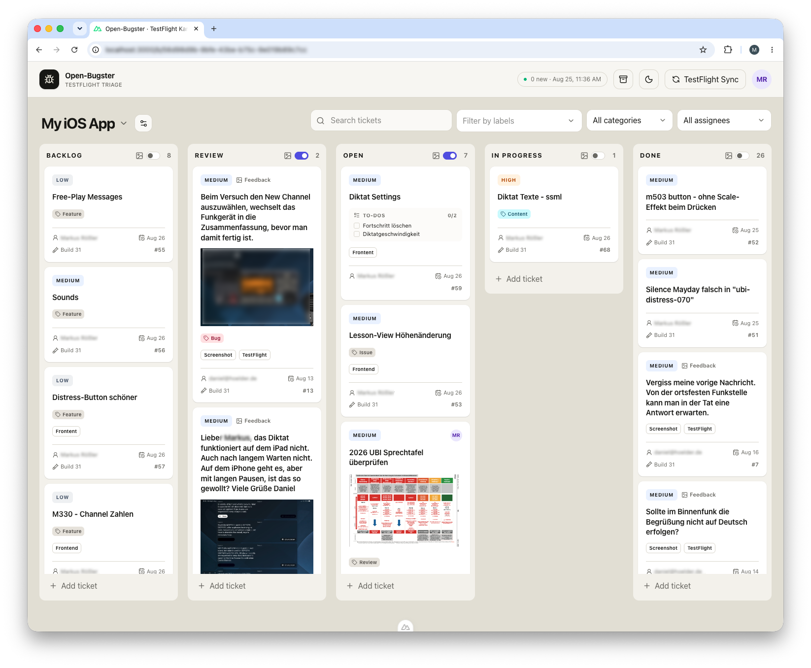

<p align="center">

</p>

# Open-Bugster

Open-Bugster is a self-hosted planning and production board for teams and the AI agents that work with them. It runs anything from a bug list to a campaign spread over several boards: Kanban boards for the daily work, tickets that nest into plans across boards, dates with dependencies and live windows on a timeline. Everything a person can do in the browser, software can do too, through a REST API, an MCP endpoint, and signed webhooks.

It began as the shortest path from TestFlight feedback to a ticket, and the App Store Connect and Jira imports still ship with it. It has since grown from a bug board into a tool for producing assets and digital campaigns, with agents as first-class colleagues.

**In three lines:**

- **Boards** for the work as it moves: lanes, drag and drop, roles, comments, history.
- **Plans** across boards: a campaign is a ticket whose subtickets live on the boards of the teams doing them, with dates, dependencies, a timeline, and a live window once it is out.
- **Agents** on the same footing as people: every action is an API call, an MCP tool, or a webhook, under the same permissions and recorded against whoever answers for it.

## Features

### Boards and tickets

- **Work as a team**  
  Real accounts with per-board roles, ticket assignment, comment threads, and a history on every ticket.
- **Workspaces and boards**  
  Group boards into workspaces for teams, clients, or brands. Every board has its own lanes, categories, labels, members, and archive. Boards can be moved or duplicated between workspaces.
- **Shape the workflow**  
  Add, rename, reorder, and remove lanes per board. Mark a lane **Done** for finished work or **Live** for work that is out in the world.
- **Ticket types**  
  Each workspace defines its own types (Ticket, Email, Social Post, Idea …), each with an icon and colour on the card.
- **Tickets with substance**  
  Markdown description, priority, assignee, labels, category, links with previews, attachments, and a to-do list, plus a comment thread and a full history.
- **Filter and search**  
  By labels, category, type, or assignee (including everything still unassigned), and across titles, descriptions, to-dos, people, build numbers, and ticket numbers.
- **Archive instead of delete**  
  Archived tickets stay restorable by a board administrator and are never re-imported.
- **Light and dark**  
  A theme toggle in the header, remembered per browser.

### Planning across boards

- **Subtickets**  
  A to-do can be a ticket of its own, on this board or another of the workspace, that ticks itself off once it reaches a done or live lane. A campaign, its waves, and its assets form one tree; **Where used** leads back up.
- **Schedule**  
  A ticket has no dates, is a **milestone** (one day: a meeting, a go-live), or has a **lifecycle**: work from start to due date, then a live window. A plain ticket stays plain.
- **Dependencies**  
  A ticket waits on others, finish to start. **Shift dates** moves a ticket and everything waiting on it, with a preview first.
- **Timeline**  
  Every ticket with subtickets has a Gantt-style timeline of its whole tree, with dependency arrows and warnings for late work, windows that do not fit, and live windows that have run out.
- **Live windows**  
  The days an asset or campaign is out in the world. The board warns before a window ends and when something is still live after it should be down, and tells webhooks and agents when a window opens, nears its end, or runs out.
- **Decisions and strict order**  
  A to-do can be a question for people to settle (which logo, which channels), recorded with who decided and when. A list can be set to strict order and worked top to bottom.
- **One alarm for every date**  
  The header lists every due date and live window across your boards, coloured by each board's lead times.

### Open to any application

- **Drive it from your own tools**  
  A versioned REST API at `/api/v1`, generated from the same definitions that validate the app itself, with a browsable reference and an OpenAPI document.
- **Connect AI agents**  
  An MCP endpoint lets Claude, Cursor, or anything else that speaks the protocol read a board or a whole plan, file and move tickets, shift schedules, and comment. An agent reaches exactly as far as its token does, and everything it does is recorded under the person or service it belongs to.
- **Push events to other systems**  
  Signed webhooks tell n8n, a chat channel, or a build pipeline when a ticket is created, updated, moved, or archived, when somebody comments, when an import finishes, and when a live window opens, nears its end, or runs out.
- **Give machines their own identity**  
  Scoped tokens, agents with a user of their own (assigned tickets, their own comments, no email needed), and an audit trail of which agent acted through which channel.

### The integrations that ship with it

- **Import TestFlight feedback**  
  Screenshots and crash reports land as tickets, with tester, device, system, build, and the original comment attached, per board, on that board's own App Store Connect credentials.
- **Import Jira issues**  
  A JQL query and an API token per board pull issues onto it once (title, description, comments, priority, reporter, attachments), and from then on the ticket is worked here. Nothing is written back to Jira.

## The idea behind Open-Bugster

**From a bug to a campaign, on one model.** A bug report, an email, a banner, and the campaign that bundles them are all tickets. What sets them apart is their type, their place in a tree of subtickets, and their schedule. That keeps the model small: there is no separate project, epic, or job object to learn, and a plan is simply a ticket you can open.

**Each team keeps its own board.** The agency, the reviewers, and the brand team each work on the board they know, with the members and lanes that suit them. The plan reaches across those boards through subtickets and dependencies, and shows people from other boards only what they may see.

**Agents are colleagues, not an add-on.** Every operation runs through one registry that serves the browser, the REST API, and the MCP tools alike, under the same roles and with the same audit. An agent can read the whole plan in one call, file the assets of a campaign, move a schedule after a dry run, or react to a webhook when an approval runs out. Opening the board to software never opens it wider than a person would be.

**A board first, still.** A ticket without a schedule has no dates and no timeline; a board that imports nothing never shows an import lane; a single workspace never shows the workspace level. Teams that only want a Kanban board get one, and the planning appears once they start using it. There are no sprints, burndowns, or workflow engine.

**Self-hosted and small enough to bend.** One container, one SQLite file, a codebase compact enough for AI-assisted coding to read and change. Add fields, change the workflow, connect other services, or deploy it wherever you like.

## Setup

Open-Bugster is one container and one data volume. You need Docker on the machine that will host it; an App Store Connect API key is only needed for the TestFlight import.

1. **Get the code.**

   ```bash
   git clone https://github.com/Roeselmann/open-bugster.git
   cd open-bugster
   ```

2. **Start it, saying who the first account is.** The email becomes your sign-in name and the owner of the instance; the password needs at least 12 characters.

   ```bash
   APP_ADMIN_EMAIL=ada@example.com APP_ADMIN_PASSWORD='a-long-password' docker compose up --build -d
   ```

3. **Sign in** at `http://<host>:3000` with that email and password, rename the default board, and invite your team from **Users** in the account menu.

The first start creates the database, the default board, the owner account, and the machine secrets, and the bootstrap variables are never read again. Everything beyond this—configuring through `.env`, managing the secrets yourself, HTTPS, where data lives, and what to do when nobody can sign in—is in [docs/setup.md](docs/setup.md). Connecting a board to TestFlight is in [docs/app-store-connect.md](docs/app-store-connect.md), to Jira in [docs/jira.md](docs/jira.md).

## Documentation

One document per feature, each written for people who want an overview and for agents that need to find the code fast. Start with [docs/README.md](docs/README.md).

| Document | Covers |
|---|---|
| [Architecture](docs/architecture.md) | The operation registry, the actor, access rules, the SQLite data layer, and the tests that guard them. The starting point for reading the code. |
| [Setup](docs/setup.md) | Docker, `.env`, secrets, HTTPS, data paths, recovering access. |
| [Backups and updates](docs/backups-and-updates.md) | The host-side scripts and why the backup is not optional. |
| [Deployment](docs/deployment.md) | Releasing by merging into `main`; the server pulls, builds, and rolls back by itself. |
| [Development](docs/development.md) | Running locally, tests, and the checklist for adding a feature. |
| [Workspaces](docs/workspaces.md) | Grouping boards, workspace administrators, moving and duplicating boards. |
| [Boards](docs/boards.md) | Boards, lanes (import, done, live), categories, labels. |
| [Tickets](docs/tickets.md) | Tickets and their types, to-dos, subtickets, decisions, schedule, dependencies, timeline, live windows, attachments, comments, history, archive, filters. |
| [Users and access](docs/users-and-access.md) | Accounts, roles, invitations, resets, anonymizing, identity by email. |
| [API](docs/api.md) | Tokens, the integration permission, service identities, REST v1, the audit trail. |
| [MCP server](docs/mcp-server.md) | The tools for AI agents and their annotations. |
| [Webhooks](docs/webhooks.md) | Signed outgoing events, including the live-window events the calendar raises; retries, destination screening. |
| [App Store Connect](docs/app-store-connect.md) | The TestFlight import, credentials, and encryption. |
| [Jira](docs/jira.md) | The one-way Jira Cloud import: API token, JQL, and what arrives on the board. |
