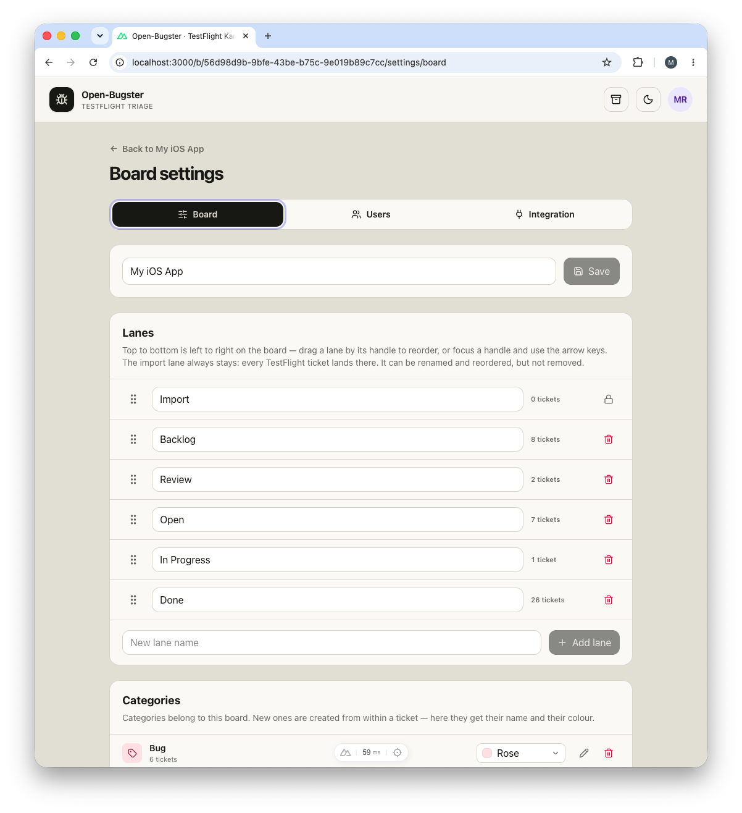

# Boards, lanes, categories, and labels

A board is one Kanban board, typically one per team, app, or channel, with its own lanes, categories, labels, members, archive, and App Store Connect credentials. An instance runs any number of boards, typically one per app or project, grouped into [workspaces](workspaces.md).

## Using it

### Boards

The board name in the header becomes a dropdown as soon as a second board exists. The icon next to it opens the board settings and is shown to board administrators only. A newly created board is selected right away and opens its settings so lanes and credentials can be set up.

The settings are split into sections: **Board** for the name, description, due date warnings, lanes, categories, moving, duplicating, and deletion; **Users** for who has access; **Integration** for the App Store Connect key; **Webhooks** for outgoing events; **Audit** for the change log.

Deleting a board removes all of it, including attachments and the stored key. Tickets on other boards are not cut short by it: one that holds a subticket from the deleted board keeps the step as a plain to-do under the subticket's title (ticked if the subticket was done), one that waited on a ticket there stops waiting, and both say so in their history. The dialog names how many tickets elsewhere this touches before it asks. The last board of an instance cannot be deleted. Over MCP only an empty board can be deleted, archived tickets included.

### Lanes

Lanes are the columns of the board and are configured under **Board settings → Board**. Drag a lane by its handle to reorder it, or focus the handle and use the arrow keys. Top to bottom in the settings is left to right on the board.

Every board opened in the UI has exactly one **import lane**, which is where imports from TestFlight and Jira land. A board opened through the API or MCP with lanes of its own starts without one; its first import adds it, named Import and leftmost (`ensureImportLane`). It can be renamed and reordered, but not deleted, and it only appears on the board once something has been imported into it.

A lane can be marked **Done** in the same list. Tickets in a done lane count as finished: their card loses its due date border and they drop out of the header's due date list. A new board starts with its Done lane marked; on upgrade, every existing board had its rightmost lane (the import lane aside) marked, since that is where finished work sat until then.

A lane can instead be marked **Live**, for work that is finished and running: a campaign in market, an asset whose approval has not expired. A lane is done or live, never both; switching one on switches the other off, and the import lane is neither. A ticket in a live lane is quiet about its due date and counts as done as a subticket, like one in a done lane, but its card follows the end of its **live window** instead: orange from the board's orange lead time before the last day, red once that day has passed and it is still live. The header's alarm lists it by that last day, and the server notes the window's opening, its coming end, and its running out in the ticket's history and as webhooks (see [webhooks.md](webhooks.md)).

When a lane is deleted, its tickets are not lost: the dialog asks whether they should move to another lane or go to the archive.

Each lane header carries a switch that shows or hides screenshot previews on its cards. The choice is remembered per lane and browser.

### Categories

A ticket has at most one category. New categories are created from within a ticket by typing a name that does not exist yet. Under **Board settings → Board** each category can be renamed in place and given one of eight color presets. The color is what the category pill uses on the cards and in the archive.

### Labels

Labels are a per-board list, edited directly in the ticket. The field suggests the board's existing labels while typing; a name that does not exist yet is offered as a new entry and created when the ticket is saved. A ticket holds up to twelve labels of thirty characters each.

Labels clean themselves up: when the last ticket that carried a label drops it, the label disappears from the board's list.

Next to the board search sits the same control as a filter. Picking several labels shows the tickets that carry **any** of them.

## How it works

- **Board access is membership.** `requireBoardAccess` answers 404 for a board the caller is not a member of, unless they are an instance administrator. Reads need `viewer`, configuration needs `admin`.
- **The import lane is a flag in the data layer**, not a convention. `deleteLane` refuses it, it is excluded from default lanes on a fresh board, and the board hides it while it is empty.
- **A board's lanes are created with it.** `board.create` takes optional `description` and `lanes`; `createBoard` writes the board and its lanes in one transaction, the seeded four when none are given. Lanes given this way are never the import lane, and live wins over done as in `updateLane`.
- **Deleting a board detaches other boards first.** `ticket_todos.subticket_id` and `ticket_dependencies` cascade with the ticket they point at, so `deleteBoard` runs `detachFromOtherBoards` inside its transaction: cross-board subticket rows become plain to-dos and each cut link is written to the other ticket's activity (`subticket` with `change: 'board_deleted'`, `waits_on` with `reason: 'board_deleted'`). `board.getDeletionImpact` (board admin, `GET /boards/{boardId}/deletion-impact`) counts the same links for the dialog.
- **Deleting a board can be made safe.** `board.delete` with `onlyIfEmpty` (what the MCP tool always sends) refuses with 409 while the board holds any ticket, archived ones included; `deleteBoard` counts and deletes in one transaction. Without it, as before, everything goes.
- **Lane deletion has three modes.** `lane.delete` takes `mode: 'move'` with a `targetLaneId`, `mode: 'archive'`, or `mode: 'empty'`, which refuses a lane with open tickets; the data layer moves or archives the tickets inside one transaction, counts for `empty` inside it too, and throws `LaneDeleteError` with a status code for the cases it refuses. Archived tickets of the lane move to the board's first lane in every mode.
- **Categories belong to a board** and are created implicitly through `ticket.create` and `ticket.update` by `categoryName`, or deliberately with `category.create` (board admin, with a colour). Names are unique per board (`CategoryNameTakenError`).
- **Labels have no create operation.** They come into being through the label list of a ticket and are pruned when unreferenced. `label.rename` and `label.delete` (board admin) address one by name, case-insensitively; renaming onto an existing name merges the two without duplicate rows in `ticket_labels`.
- **The structure log is a viewer's read.** `board.structure.list` returns the successful `board.create`, `board.update`, `lane.*`, `member.set`, `member.remove`, `category.*` and `label.*` entries of the audit log for one board, with their allowlisted `changes` and the target's current name. `listBoardStructureAudit` matches `board.create` by its target, since that row has no board id.
- **A board always keeps at least one administrator**; `member.remove` and `member.set` refuse to demote or remove the last one.
- **Board names** are at most 40 characters, descriptions 200, lane and category names 30.

## Code map

| File | What lives there |
|---|---|
| [server/operations/board-domain.ts](../server/operations/board-domain.ts) | `board.list` (authenticated), `board.get` (viewer), `board.create` (workspace admin), `board.update`, `board.move`, `board.duplicate`, `board.delete` (board admin); `lane.list` (viewer), `lane.create`, `lane.update`, `lane.reorder`, `lane.delete` (admin); `category.list` (viewer), `category.create`, `category.update`, `category.delete` (admin); `label.list` (viewer), `label.rename`, `label.delete` (admin); `member.list` (viewer), `member.candidates`, `member.set`, `member.remove` (admin); `board.structure.list` (viewer), with `structureOperations`. |
| [server/utils/audit.ts](../server/utils/audit.ts) | `listBoardStructureAudit`, the viewer-safe slice of the log behind `board.structure.list`. |
| [server/utils/db.ts](../server/utils/db.ts) | Boards: `listBoards`, `accessibleBoardIds`, `boardRoleFor`, `findBoard`, `createBoard`, `updateBoard`, `deleteBoard`, `countBoards`. Lanes: `createLane`, `updateLane`, `reorderLanes`, `deleteLane`, `LaneDeleteError`. Categories: `listCategories`, `createCategory`, `updateCategory`, `deleteCategory`. Labels: `listLabels`, `renameLabel`, `deleteLabel`. `BoardNotEmptyError`. Members: `boardMembers`, `setBoardMember`, `removeBoardMember`, `countBoardAdmins`. Tables `boards`, `lanes`, `categories`, `labels`, `ticket_labels`, `board_members`. |
| [server/utils/validation.ts](../server/utils/validation.ts) | `boardCreateSchema`, `boardUpdateSchema`, `laneSchema`, `categoryUpdateSchema`, and the label length rule. |
| [shared/types/domain.ts](../shared/types/domain.ts) | `Board`, `BoardSummary`, `Lane`, `LaneSummary`, `Category`, `CategorySummary`, `CategoryColor`, `LabelSummary`, `BoardMember`, `BoardRole`. |
| [shared/utils/constants.ts](../shared/utils/constants.ts) | `CATEGORY_COLOR_LABELS`, `CATEGORY_TONE_CLASSES` (hand-written CSS classes, because Tailwind cannot scan class names that only exist as strings). |
| `app/composables/useBoards.ts` | Board list state, `useCurrentBoard`, `useLastBoardId` (cookie `open-bugster-board`), `useCanAutomate`. |
| `app/components/BoardSwitcher.vue`, `AppHeader.vue` | The header dropdown and the settings icon. |
| `app/components/BoardLaneSettings.vue`, `BoardCategorySettings.vue`, `BoardMemberSettings.vue` | The settings panels. |
| `app/pages/b/[board]/settings.vue` and `settings/board.vue`, `users.vue` | The settings shell and the two sections this document covers. |
| `app/middleware/board.ts` | Resolves `:board` into the current board or 404s. |

## Surfaces

- **Internal routes:** `server/api/boards/index.get.ts`, `index.post.ts`, `[id].patch.ts`, `[id].delete.ts`, `[id]/move.post.ts`, `[id]/duplicate.post.ts`, `[id]/lanes/index.post.ts`, `[id]/lanes/[laneId].patch.ts`, `[id]/lanes/[laneId].delete.ts`, `[id]/lane-order.patch.ts`, `[id]/members/*`; `server/api/categories/index.get.ts`, `[id].patch.ts`, `[id].delete.ts`; `server/api/labels/index.get.ts`.
- **REST v1:** `GET|POST /boards` (`POST` takes `description` and `lanes` beside `name`), `GET|PATCH|DELETE /boards/{boardId}` (`DELETE ?onlyIfEmpty=true` refuses while any ticket is left, archived ones included), `GET /boards/{boardId}/structure-log`, `GET|POST /boards/{boardId}/lanes` (`POST` takes `isDone` and `isLive`, and answers with the new `lane` too), `PATCH|DELETE /boards/{boardId}/lanes/{laneId}` (`DELETE` takes `mode` `move`, `archive` or `empty` as a query parameter), `PATCH /boards/{boardId}/lane-order`, `GET /boards/{boardId}/members`, `GET /boards/{boardId}/member-candidates`, `PUT|DELETE /boards/{boardId}/members/{userId}`, `GET|POST /boards/{boardId}/categories`, `PATCH|DELETE /categories/{categoryId}`, `GET /boards/{boardId}/labels`, `PATCH|DELETE /boards/{boardId}/labels/{name}` (the name percent-encoded; `PATCH` takes `newName`).
- **MCP:** `list_boards`, `board_overview`, `list_lanes`, and the structure tools `create_board`, `update_board`, `delete_board`, `save_lane`, `delete_lane`, `member_candidates`, `set_board_member`, `remove_board_member`, `edit_label`, `edit_category`; `whats_new` reports their changes under `structure`. See [mcp-server.md](mcp-server.md#structure).
- **Webhooks:** none of the operations here emit an event. Webhooks are about tickets, comments, and imports.

## Tests

- `tests/lanes.test.ts`: boards and lanes, including both lane deletion modes and the import lane rule.
- `tests/workspaces.test.ts`: board move and duplicate.
- `tests/accounts.test.ts`: board membership and the last-administrator rule.
